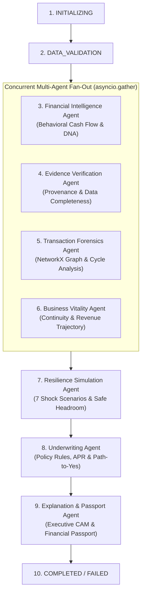

<<<<<<< HEAD
# UDYOGA — Beyond Credit. Beyond Barriers.

> **Next-Generation Agentic AI Financial Intelligence & Resilience-Based Flow Lending Platform for India's Credit-Invisible MSMEs**

---

## 1. Executive Summary & Problem Statement

In India, over **63 million Micro, Small, and Medium Enterprises (MSMEs)** generate more than 30% of the nation's GDP and employ upwards of 110 million citizens. Yet, over **85% remain credit-invisible or credit-underserved**, constrained by a multi-billion dollar credit gap. 

Traditional institutional underwriting models rely predominantly on **static collateral, formal audited balance sheets, and multi-year credit bureau scores**. India's informal and micro-enterprises operate primarily on dynamic cash cycles: high-velocity daily UPI transactions, merchant QR settlements, bank transfers, and local trade credit. 

**UDYOGA** replaces static asset-based collateral hurdles with **behavioral financial intelligence, evidence triangulation, forensic transaction graph auditing, and deterministic cash-flow resilience simulation**. It evaluates repayment capacity under economic stress and produces transparent, explainable credit recommendations.

---

## 2. Core Architectural Principles & Guarantees

1. **100% Deterministic Financial Arithmetic**: All financial calculations—including cash velocity, DSCR, loan affordability ceilings, and multi-scenario shock simulations—are implemented in deterministic Python using exact Decimal precision (`pandas`, `numpy`, `networkx`).
2. **No Bureau Score Claims**: UDYOGA does not claim to generate artificial 300–900 credit bureau scores. It outputs transparent assessment statuses (`INDICATIVE_RECOMMENDATION`, `CONDITIONAL_RECOMMENDATION`, `HUMAN_REVIEW_REQUIRED`, `INSUFFICIENT_EVIDENCE`, `NOT_RECOMMENDED`) and explainable financial risk bands.
3. **Absence $\neq$ Negative Evidence**: Missing records (such as sub-threshold GST exemption for micro-enterprises) are classified as neutral epistemic uncertainty and lower evidence confidence without penalizing underlying cash-flow health.
4. **Forensic Graph Investigation (No Automated Fraud Verdicts)**: Topological graph anomalies (such as circular fund loops or high counterparty concentration) flag applications for `HUMAN_REVIEW_REQUIRED` rather than generating automated fraud convictions.
5. **Obligation-Level Debt Reconciliation**: Cash-flow affordability reconciles declared obligations with verified bank recurring debits on an individual obligation level, preventing double-counting while capturing undeclared debt service.
6. **Deterministic Rule-Based Fallback**: If LLM narrative synthesis is unavailable, unconfigured, or encounters latency, a fully populated, rule-based Credit Appraisal Memo is generated without failure.
7. **Zero Private Chain-of-Thought Leakage**: Internal LLM thinking is strictly excluded from client-facing streams, logs, and APIs. Server-Sent Events expose only structured agent tasks, tool calls, findings, and statuses.

---

## 3. Agentic AI Multi-Agent Architecture

UDYOGA employs a specialized multi-agent architecture coordinated by a 10-stage asynchronous state machine:



### Specialized Agents

- **Financial Intelligence Agent**: Analyzes transaction credits/debits, calculates net operating cash flow, daily average inflow, cash velocity in days, inflow volatility coefficient of variation ($CV$), and customer/supplier volume concentration.
- **Evidence Verification Agent**: Audits data provenance across data streams (`USER_PROVIDED`, `SOURCE_LABELLED`, `INDEPENDENTLY_VERIFIED`, `MISSING`).
- **Transaction Forensics Agent**: Constructs directed counterparty transaction graphs using NetworkX. Analyzes Shannon entropy and identifies circular fund loops ($A \to B \to C \to A$) for human review.
- **Business Vitality Agent**: Evaluates operational vintage, month-over-month revenue growth trajectory, seasonality indices, and early-warning distress indicators.
- **Resilience Simulation Agent**: Reconciles debt obligations and runs a 7-scenario macroeconomic stress suite (-15% revenue drop, -30% 2-month shock, +15% COGS inflation, 30-day payment delays, combined shocks, seasonal downturns). Calculates post-shock DSCR, cash runway, and maximum affordable principal ($P_{\max}$).
- **Underwriting Agent**: Applies policy rules, caps loan principal by cash-flow affordability, determines risk-based APR spreads (13.0%–18.5%), and executes counterfactual "Path-to-Yes" simulations.
- **Explanation & Passport Agent**: Compiles the Business Financial Passport and Credit Appraisal Memo (CAM) with clear data provenance, assumptions, and limitations.

---

## 4. Technology Stack

### Backend
- **Language & Runtime**: Python 3.12+
- **API Framework**: FastAPI (Async REST & Server-Sent Events)
- **Data Validation & Schemas**: Pydantic v2 & Pydantic Settings
- **Deterministic Analytics**: Pandas, NumPy, NetworkX
- **Database & Event Bus**: SQLite (via aiosqlite), in-memory async event bus
- **Testing**: Pytest & pytest-asyncio / AnyIO (55 passing unit and integration tests)

### Frontend
- **Framework & Build**: React 18, TypeScript, Vite
- **Styling & Design System**: Tailwind CSS, Radix UI primitives
- **Data Visualization & Icons**: Recharts, Lucide Icons
- **Animation & Polish**: Framer Motion, Canvas Confetti, Sonner Toasts
- **Web3 Trust Anchor**: Quai Network (Cyprus-1) Audit Anchor Contract (`UdyogaAuditAnchor.sol`)

---

## 5. Team Ownership & Module Responsibilities

| Teammate | Focus Area | Directory Scope | Implementation Status |
|---|---|---|---|
| **Atharv** | System Architecture, Backend API, Multi-Agent State Machine, Resilience & Affordability, Underwriting Engine | `backend/app/api/`<br/>`backend/app/modules/agents/`<br/>`backend/app/modules/resilience_engine/`<br/>`backend/app/modules/underwriting/`<br/>`backend/app/schemas/` | **Implemented & Verified** (55 passing tests) |
| **Harshitha** | Transaction Ingestion, Financial DNA Engine, Graph Topological Analysis | `backend/app/modules/financial_intelligence/` | Interface defined; agent integration adapters active |
| **Amulya** | Synthetic MSME Data, Evidence Confidence Scorer, Fairness Auditor, Explainability | `backend/app/modules/trust_evidence/` | Interface defined; agent integration adapters active |
| **Bharath** | Complete React Frontend, UI/UX, Dashboards, Live Agent Terminal, Interactive Shock Slider | `frontend/` | Components, layouts, and views established |

---

## 6. Getting Started & Setup

### Prerequisites
- Python 3.11+ / 3.12+
- Node.js 18+ & npm 9+

### Backend Setup

1. **Activate virtual environment:**
   ```bash
   cd UDYOGA
   # Windows PowerShell:
   .\.venv\Scripts\Activate.ps1
   # Linux/macOS:
   source .venv/bin/activate
   ```

2. **Install dependencies:**
   ```bash
   pip install -r backend/requirements.txt
   ```

3. **Configure Environment:**
   ```bash
   cp .env.example .env
   ```

4. **Run FastAPI Backend Server:**
   ```bash
   python -m uvicorn backend.app.main:app --reload --port 8000
   ```
   - Interactive Swagger API Docs: [http://localhost:8000/docs](http://localhost:8000/docs)
   - Alternative ReDoc: [http://localhost:8000/redoc](http://localhost:8000/redoc)

### Frontend Setup

1. **Install dependencies:**
   ```bash
   npm install --prefix frontend
   ```

2. **Run Vite Development Server:**
   ```bash
   npm run dev --prefix frontend
   ```
   - Local UI Dashboard: [http://localhost:5173](http://localhost:5173)

3. **Run Production Build:**
   ```bash
   npm run build --prefix frontend
   ```

---

## 7. Verified Backend API Endpoints

| Method | Endpoint | Description |
|---|---|---|
| `GET` | `/api/v1/health` | Service health and subsystem readiness check |
| `GET` | `/api/v1/status` | Architectural policy guarantees and calculation version |
| `GET` | `/api/v1/business/demo/scenarios` | Pre-seeded demo MSMEs (Kirana, Textile Weaving, Surat Trading) |
| `POST` | `/api/v1/business/` | Register and validate a new MSME profile |
| `GET` | `/api/v1/business/{business_id}` | Retrieve business profile and declared parameters |
| `POST` | `/api/v1/transactions/upload-csv` | Upload bank / UPI statement CSV with automatic parsing |
| `POST` | `/api/v1/transactions/batch` | Batch programmatic transaction record ingestion |
| `GET` | `/api/v1/transactions/summary/{business_id}` | Ingested transaction summary, totals, and date range |
| `POST` | `/api/v1/resilience/simulate` | Interactive cash-flow stress simulator with 7 shock scenarios |
| `POST` | `/api/v1/assessment/run` | Launch asynchronous 10-stage multi-agent assessment pipeline |
| `GET` | `/api/v1/assessment/{assessment_id}/stream` | Real-time Server-Sent Events (SSE) audit trail |
| `GET` | `/api/v1/assessment/{assessment_id}/events` | Audit event history array for review and verification |
| `GET` | `/api/v1/assessment/{assessment_id}/result` | Full Credit Appraisal Memo (CAM), covenants, and counterfactuals |

---

## 8. Verification & Test Suite

The backend test suite verifies all mathematical calculations, policy thresholds, agent state machine execution, and SSE event ordering:

```bash
.\.venv\Scripts\pytest.exe backend/tests/ -v
```

All **55 unit and integration tests** pass deterministically.

---

## 9. Repository Governance & Branch Strategy

- **Production / Showcase Branch:** `main`
- **Feature Branches:** `feature/<name>-<scope>` (e.g., `feature/atharv-ai`)
- **Integration Backups:** `backup/<scope>-before-merge`
- **Commit Format:** Conventional Commits (`feat:`, `fix:`, `merge:`, `docs:`, `test:`, `refactor:`)
=======
# UDYOGA — Next-Generation MSME Credit Underwriting & Flow-Based Lending Platform

UDYOGA is an intelligent, high-integrity financial infrastructure platform designed to democratize credit access for Micro, Small, and Medium Enterprises (MSMEs) through alternative credit evaluation, cash-flow verification, and transparent underwriting.

---

## 📌 Repository Strategy & Governance

- **Main / Production Branch:** `main`
- **Primary Development Branch:** `develop`
- **Feature Branches:** `feature/phase-<number>-<scope>`
- **Commit Standard:** [Conventional Commits](https://www.conventionalcommits.org/)

---

## 🚀 Development Phases

- **Phase 1:** MSME Credit Market Research & Underwriting Landscape
- **Phase 2:** Product Strategy, User Journeys & MVP Scope
- **Phase 3:** Architecture & API Specifications
- **Phase 4:** Design System & UI Component Foundation
- **Phase 5A:** Public Portal & Borrower Journey
- **Phase 5B:** Lender Underwriting Dashboard
- **Phase 5C:** Admin & Algorithmic Fairness Monitoring
- **Phase 6:** Backend & Alternative Credit Engine (ACIE) Integration
- **Phase 7:** Quality Assurance, Security Hardening & Demo Readiness
>>>>>>> origin/feature/harshitha-finance
