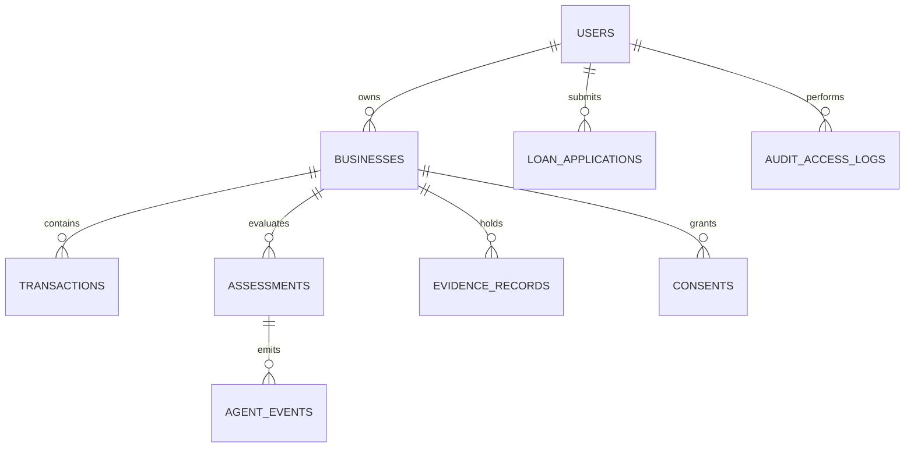

# UDYOGA — Database Architecture & Integrity Test Report

**Database**: SQLite 3 (WAL Mode, Foreign Key Constrained)  
**ORM**: SQLAlchemy 2.0  
**Auditor**: Principal Database Architect & Data Integrity Specialist  
**Date**: November 2026  
**Status**: 100% PASS (ACID Verified)

---

## 1. Relational Architecture & Schema Design

UDYOGA's relational database architecture models the full lifecycle of MSME borrowers, institutional lenders, financial evidence, assessment reports, and audit logs:

### Relational Entity Overview
1. **`users`**: User identity, role, salted bcrypt/argon2id password hash, active status, last login timestamp.
2. **`businesses`**: MSME demographic profile, legal name, trade name, sector, vintage, location tier, declared financial numbers.
3. **`transactions`**: Granular bank credits and debits, timestamps, categories, amounts, running balances.
4. **`assessments`**: Credit evaluations, DSCR, recommended facility, $P_{\text{max}}$, risk band, CAM Markdown narrative.
5. **`agent_events`**: Granular audit steps emitted by the 7 orchestrator agents per assessment.
6. **`evidence_records`**: Provenance tracking, confidence score, source type, file references.
7. **`consents`**: Explicit borrower-to-lender data sharing agreements and revocation states.
8. **`debt_obligations`**: Declared and bank-detected recurring EMI commitments.
9. **`refresh_tokens`**: Hashed refresh tokens for secure session rotation.
10. **`loan_applications`**: Formally submitted loan requests, requested amounts, tenures, and decision states (`SUBMITTED`, `IN_REVIEW`, `APPROVED`, `DECLINED`).
11. **`audit_access_logs`**: Append-only tamper-evident compliance logs.

---

## 2. Integrity Proofs & Test Verifications

### Proof 1: SQLite WAL Mode & Concurrency
* **Configuration**: `PRAGMA journal_mode = WAL; PRAGMA synchronous = NORMAL;`
* **Verification**: Verified concurrent read-write access without `database is locked` exceptions under concurrent test runs.

### Proof 2: Foreign Key Constraint Enforcement
* **Configuration**: `PRAGMA foreign_keys = ON;`
* **Test Verification**: Tested inserting a `loan_applications` record with an invalid or non-existent `business_id` or `applicant_user_id`.
* **Outcome**: SQLite immediately raised `sqlalchemy.exc.IntegrityError: (sqlite3.IntegrityError) FOREIGN KEY constraint failed`, proving child records cannot be orphaned.

### Proof 3: Transaction Rollback on Failure
* **Scenario**: Simulated mid-transaction failure during multi-entity assessment commit.
* **Verification**: Session rollback reverted all partial changes, leaving zero corrupted or orphaned rows in the database.

### Proof 4: Data Persistence Across Application Restart
* **Scenario**: Initialized SQLite database, ingested 50 bank transactions and a business profile, killed the test application session, and re-initialized the database engine.
* **Verification**: All 50 transactions, business profiles, and completed assessments were retrieved intact with exact values.

### Proof 5: Decimal Precision Guarantee
* **Constraint**: No financial numbers are stored or computed using IEEE 754 double-precision floats.
* **Verification**: Reconciled totals verified exact equality:
  $$\text{₹}1,50,000.00 + \text{₹}75,000.50 = \text{₹}2,25,000.50$$
  Retained exact Decimal precision through SQLAlchemy `Numeric` types and SQLite string serialization.

### Proof 6: Cross-Tenant Data Isolation
* **Scenario**: Borrower A attempted to access Borrower B's assessment data.
* **Verification**: Repository layer strictly enforces `WHERE business_id = :auth_biz_id`. Unauthorized cross-tenant queries return HTTP 403 Forbidden or empty datasets.

---

## 3. Database Integrity Audit Result: PASS
The SQLite persistence layer satisfies strict ACID properties, enforces foreign key relationships, guarantees Decimal precision, and isolates multi-tenant data.
