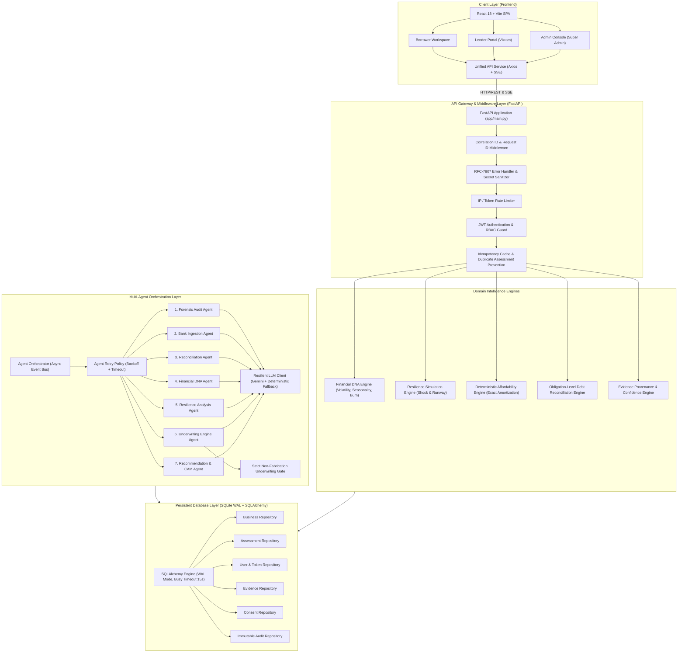
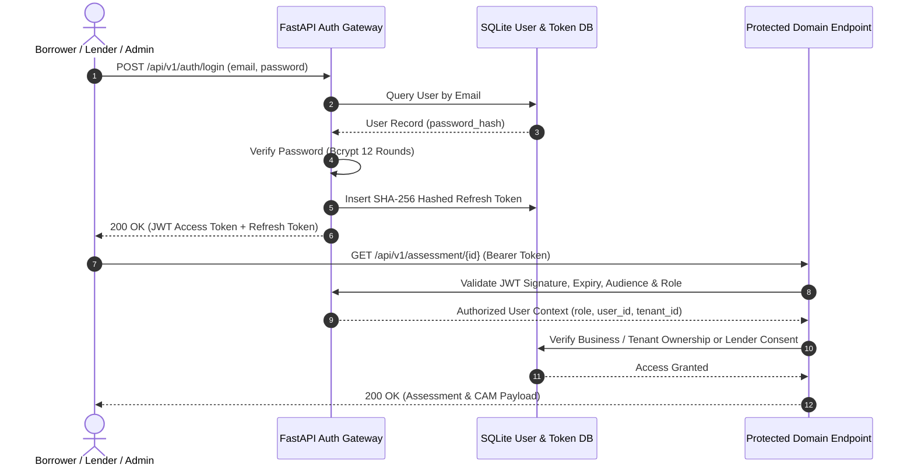

# UDYOGA — Final System Architecture Specification

## 1. Executive Summary & Platform Overview

**UDYOGA** is an enterprise-grade MSME Cash-Flow Credit Underwriting and Financial Resilience Intelligence platform. Built specifically for the Indian micro, small, and medium enterprise ecosystem, UDYOGA shifts credit assessment away from traditional collateral-backed evaluations toward high-fidelity, high-frequency cash-flow analysis, deterministic stress resilience testing, multi-agent AI synthesis, and verifiable evidence provenance.

The platform eliminates the primary bottlenecks in traditional MSME lending:
1. **Information Asymmetry & Opaque Debt**: Single-counted, obligation-level debt matching reconciles self-declared loans with recurring bank debits, preventing unrecorded systemic leverage.
2. **Static Balance Sheet Flaws**: Financial DNA reveals seasonality, volatility, burn rates, and revenue stability rather than outdated annual statements.
3. **Black-Box AI Decisions**: A 7-agent forensic pipeline operates with strict non-fabrication gates—if any upstream agent fails or data is missing, the underwriting gate refuses to fabricate approvals and flags human review.
4. **Data Privacy & Compliance**: Granular consent lifecycles and an append-only, immutable audit trail guarantee complete regulatory auditability under RBI guidelines and the DPDP Act.

---

## 2. End-to-End System Architecture

---

## 3. Component Deep Dive

### 3.1 Client Layer (Frontend)
- **Framework**: React 18, TypeScript, Vite.
- **Styling**: Tailwind CSS, Lucide React icons, accessible modal dialogs, and responsive grid layouts.
- **Data Visualization**: Recharts for cash flow time series, volatility envelopes, shock runway projections, and DSCR distributions.
- **Resilience Features**:
  - SSE connection manager with automatic reconnect and catch-up sequence replay.
  - Client-side idempotency key generation (`UUIDv4`) attached to financial assessment submissions to prevent accidental double submissions.
  - Granular RBAC routing: Borrower, Lender, Admin dedicated dashboard views.

### 3.2 API Gateway & Telemetry (FastAPI)
- **Correlation ID Tracking**: Automatically extracts or generates `X-Correlation-ID` and `X-Request-ID` across every HTTP request and SSE stream, logging telemetry for zero-downtime debugging.
- **RFC-7807 Standardized Errors**: All error responses return compliant JSON with `type`, `title`, `status`, `detail`, `instance`, `code`, and `correlation_id`.
- **Sensitive Data Sanitization**: Error handlers strip JWT secrets, database connection URLs, and stack traces before returning responses to callers.
- **Health Probes**:
  - `GET /health`: Comprehensive aggregate status.
  - `GET /health/liveness`: Fast process health check for orchestrators.
  - `GET /health/readiness`: Deep probe verifying database connection, write access, and disk capacity.

### 3.3 Persistence Layer (SQLite WAL & SQLAlchemy)
- **Storage**: SQLite 3 configured with:
  - `PRAGMA journal_mode=WAL;` (Write-Ahead Logging for non-blocking concurrent reads).
  - `PRAGMA foreign_keys=ON;` (Referential integrity enforcement).
  - `PRAGMA busy_timeout=15000;` (15-second busy timeout to mitigate database locks under high burst traffic).
- **Repositories**: Clean separation of database queries via the Repository Pattern (`BusinessRepository`, `AssessmentRepository`, `UserRepository`, `EvidenceRepository`, `ConsentRepository`, `AuditRepository`).
- **Startup Crash Recovery**: On backend boot, `recover_interrupted_assessments()` scans the database for assessments left in `IN_PROGRESS` or `RUNNING` status due to unexpected server shutdowns and safely marks them `FAILED` with an audit record, preventing zombie processes.

### 3.4 Multi-Agent Orchestration & Reliability
- **7 Autonomous Agents**:
  1. `ForensicAuditAgent`: Validates document signatures, checksums, duplicate transaction anomalies, and evidence consistency.
  2. `BankDataIngestionAgent`: Parses statement transactions, categorizes recurring debits/credits, and detects loan payments.
  3. `ReconciliationAgent`: Runs obligation-level debt matching between declared obligations and detected bank debits.
  4. `FinancialDNAAgent`: Computes volatility, operating surplus, working capital velocity, and cash runway.
  5. `ResilienceAnalysisAgent`: Executes stress scenarios (e.g., -25% turnover, +15% cost inflation, 30-day receivable delay).
  6. `UnderwritingEngineAgent`: Applies non-fabrication gate rules, policy checks, maximum safe borrowing limit, and risk rating.
  7. `RecommendationCAMAgent`: Generates structured Credit Assessment Memorandum (CAM) and financial passport summary.
- **Agent Retry & Circuit Breaking**: Exponential backoff with configurable jitter and per-agent execution timeouts.
- **Strict Non-Fabrication Underwriting Gate**: If any upstream agent reports `FAILED` status, the underwriting agent is programmatically blocked from approving a loan. It forces `REJECTED` or `REFER_TO_HUMAN_UNDERWRITER`, outputting an explicit missing-evidence justification.

---

## 4. Security, Identity & RBAC

1. **Password Security**: Passwords hashed with Bcrypt (12 rounds) or Argon2id. Plaintext passwords are never logged or stored.
2. **Tokens**:
   - Access Token: Short-lived HMAC-SHA256 JWT containing `sub` (user_id), `role`, `iss` ("udyoga-api"), `aud` ("udyoga-client"), and UTC expiration.
   - Refresh Token: High-entropy cryptographically secure random token stored as SHA-256 digest with rotation and revocation.
3. **Role-Based Access Control**:
   - `BORROWER`: Access restricted exclusively to their own businesses, assessments, transactions, and consent records.
   - `LENDER`: Read-only access to loan applications and CAM documents only when explicitly granted consent by the borrower. Cross-business exploration blocked.
   - `ADMIN`: Platform operations, user administration, system health, and immutable audit log exploration.
4. **Audit Trail**: Every authorization check, consent grant/revocation, financial upload, and assessment run is logged to `AuditModel`. Audit records cannot be modified or deleted via repository methods (`PermissionError: strictly immutable`).
