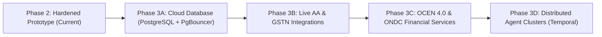

# UDYOGA — Known Limitations and Future Roadmap

## 1. Known Architectural & Operational Limitations

### 1.1 Persistence & Concurrency (SQLite WAL Mode)
- **Current State**: UDYOGA utilizes SQLite 3 enhanced with Write-Ahead Logging (`PRAGMA journal_mode=WAL`), foreign key enforcement (`PRAGMA foreign_keys=ON`), and a 15-second busy timeout (`PRAGMA busy_timeout=15000`).
- **Limitation**: While WAL mode allows unlimited concurrent readers alongside a writer, SQLite enforces a single-writer lock at the filesystem level. Under high-frequency concurrent write traffic (>50 concurrent write transactions per second), lock contention may cause brief latency spikes.
- **Suitability**: Perfectly suited for single-node deployments, on-premise local evaluations, and hackathon demonstration workloads.

### 1.2 External Banking & Regulatory Networks (Account Aggregator & GSTN)
- **Current State**: Bank statement ingestion, transaction reconciliation, and GST compliance data are parsed from standard CSV/PDF files and structured data schemas.
- **Limitation**: Direct live integration with the RBI-regulated Account Aggregator (AA) network (e.g., Sahamati, Setu, OneMoney) and the GSTN GSP API requires official institutional NBFC-AA licensing, PKI digital certificates, and production regulatory sandbox keys.
- **Mitigation**: UDYOGA accepts standard bank statement exports across major Indian banks (SBI, HDFC, ICICI, Axis, PNB) and provides realistic AA-compliant mock schemas for live jury demonstrations.

### 1.3 LLM Quota & Fallback Nuance
- **Current State**: The multi-agent pipeline is powered by Google Gemini with structured JSON output enforcement and a resilient client wrapper.
- **Limitation**: When external LLM APIs experience network latency, rate limit quotas (HTTP 429), or unavailable endpoints, the platform triggers deterministic fallback heuristics. While fallback data preserves 100% mathematical accuracy and underwriting policy logic, the dynamic conversational prose of agent thoughts is replaced by standardized policy narratives.

### 1.4 Single-Process Rate Limiting
- **Current State**: IP and token rate limiting operates as an in-memory sliding window middleware.
- **Limitation**: In a multi-worker or multi-container horizontal scale-out deployment, rate limit counters are not shared across processes.

---

## 2. Post-Hackathon Strategic Roadmap

### Phase 3A: Enterprise Database & Cloud Infrastructure
- **Target**: PostgreSQL 16 with TimescaleDB extension for high-velocity cash flow time series.
- **Migrations**: Automated database schema migrations using Alembic.
- **Connection Management**: PgBouncer connection pooling for thousands of concurrent borrower and lender sessions.
- **Distributed Cache & Rate Limiting**: Redis Cluster for centralized token blacklists, SSE pub/sub messaging, and global rate limiting.

### Phase 3B: Live Account Aggregator & Government API Integrations
- **Sahamati AA Integration**: Full implementation of the FIP/FIU (Financial Information Provider/User) protocol with digital consent flow.
- **Direct GSTN Connector**: Automated verification of GSTR-1, GSTR-3B, and e-way bills directly from the Goods and Services Tax Network.
- **PAN / MCA Validation**: Automated Ministry of Corporate Affairs (MCA21) company registration and director DIN verification.

### Phase 3C: OCEN 4.0 & ONDC Protocol Compliance
- **Open Credit Enablement Network (OCEN)**: Implement OCEN 4.0 APIs to act as a certified Loan Service Provider (LSP) or Underwriting Engine for Digital Public Infrastructure.
- **Open Network for Digital Commerce (ONDC)**: Enable embedded purchase financing and invoice discounting directly at the point of merchant checkout.

### Phase 3D: Multi-Modal Document OCR & Fraud Detection
- **Computer Vision Pipeline**: Ingestion and optical character recognition (OCR) for scanned paper invoices, utility bills, and handwritten ledgers.
- **Deepfake & Tampering Detection**: Cryptographic analysis of PDF metadata and font rendering trees to flag doctored bank statements.

### Phase 3E: Distributed Multi-Agent Scheduling
- **Temporal / Celery Orchestration**: Decouple the 7-agent pipeline into distributed background micro-workers for asynchronous portfolio underwriting and automated loan monitoring.
- **Continuous Monitoring Agents**: Autonomous agents that monitor live borrower cash flows post-disbursal, predicting distress up to 60 days before EMI default.
