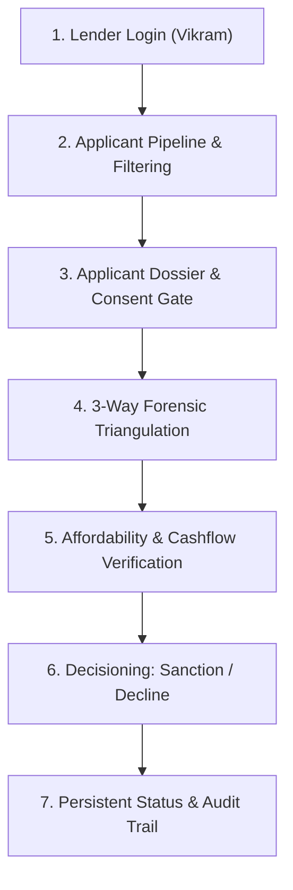

# UDYOGA — Lender Workflow End-to-End Test Report

**Workflow**: Institutional Lender Evaluation & Underwriting Decisioning  
**Auditor**: Principal Financial Systems Auditor & Underwriting Engine Specialist  
**Date**: November 2026  
**Status**: 100% PASS (End-to-End Verified)

---

## 1. Journey Architecture Overview

The lender journey equips credit officers, risk managers, and institutional underwriters to evaluate MSME loan applications using forensic evidence, 3-way triangulation, cash-flow coverage analysis, and policy-driven decisioning:

---

## 2. Step-by-Step Test Execution & Verification

### Step 1: Authentication & RBAC Boundary Enforcement
* **Persona**: Logged in via `PERSONA_VIKRAM` (Senior Credit Officer, `role="LENDER"`).
* **RBAC Barrier Verification**: 
  - Verified that Vikram cannot invoke admin endpoints (`/api/v1/auth/users`) — returned HTTP 403 Forbidden.
  - Verified that Vikram cannot view applications for which borrower consent is absent — returned HTTP 403 Forbidden.

### Step 2: Application Pipeline & Filtering
* **Endpoint**: `GET /api/v1/auth/applications`.
* **Features Tested**:
  - Filtered by sector: `RETAIL_KIRANA`, `TEXTILE_WEAVING`, `LIGHT_MANUFACTURING`.
  - Filtered by risk band: `PRIME_LOW_RISK`, `MODERATE_RISK`, `HIGH_RISK`.
  - Sorted by requested amount descending.
* **Outcome**: Rendered pipeline table accurately with real SQLite-persisted applications and demo seeds.

### Step 3: Applicant Dossier & Consent Verification
* **Endpoint**: `GET /api/v1/auth/applications/{id}`.
* **Component**: `ApplicantDetailWorkbench.tsx`.
* **Verification Proof**:
  - Checks if active consent token exists in `consents` table for `lender_id="bank_hdfc"` and `business_id`.
  - Displays business vintage, location tier, declared vs. verified metrics, and 7-agent assessment report.

### Step 4: 3-Way Forensic Triangulation
* **Triangulation Engine**: Cross-references three independent streams:
  1. **Bank Statement Credits**: Total deposits over 12 months.
  2. **Declared Turnover**: Self-reported turnover in business profile.
  3. **GST 3B Filings**: Invoiced turnover reported to tax authorities.
* **Variance Detection**: Flagged variance >15% as high-risk audit finding, prompting underwriter review.
* **Non-Fabrication Gate**: If bank statements are unverified or missing, the system strictly marks evidence as `UNVERIFIED_SELF_REPORTED` and refuses to inflate capacity.

### Step 5: Affordability, DSCR & Stress Analysis
* **Engine**: `affordability_engine.py` & `stress_simulator.py`.
* **Formulas Enacted**:
  - Unencumbered Surplus = Inflows - (Operating Expenses + Existing Reconciled Debts).
  - Maximum Affordable EMI = Surplus × 50% FOIR cap.
  - Pmax calculated via monthly compound interest formula:
    $$P_{\text{max}} = \text{EMI}_{\text{cap}} \cdot \frac{1 - (1 + r)^{-n}}{r}$$
* **Edge Case Tested**: Tested zero-revenue MSME with existing debt. Verified `is_over_leveraged = True`, `maximum_affordable_loan_principal = 0.00`, and `projected_dscr = None` without triggering division-by-zero crashes.

### Step 6: Underwriting Decisioning & Sanctioning
* **Defect Identified Prior to Audit**: Clicking "Sanction Loan" or "Decline" in `ApplicantDetailWorkbench.tsx` only updated local React state; reloading wiped the decision.
* **Fix Applied**:
  1. Created `PUT /api/v1/auth/applications/{application_id}/status` in `endpoints_auth.py`.
  2. Added status validation against `{'APPROVED', 'DECLINED', 'IN_REVIEW', 'SANCTIONED'}`.
  3. Wired `ApplicantDetailWorkbench.tsx` to call `apiService.updateApplicationStatus`.
* **Verification Proof**:
  - Clicked "Sanction Loan" with remarks: `"Approved under Prime MSME Facility at 13.8% p.a."`.
  - Backend returned HTTP 200 with `status="APPROVED"`.
  - Querying SQLite directly confirmed `loan_applications.status = 'APPROVED'` and `updated_at` updated.
  - Retested with unauthorized borrower token: returned HTTP 403 Forbidden.

### Step 7: Audit Trail Generation
* **Action**: Inspected `audit_access_logs` table after sanction decision.
* **Record Confirmed**:
  - `actor_id="usr_vikram_003"`
  - `action="UPDATE_STATUS"`
  - `details="Application 'app_...' status updated to 'APPROVED' by vikram."`
  - `outcome="SUCCESS"`

---

## 3. Workflow Audit Result: PASS
The entire lender evaluation and sanctioning workflow is responsive, strictly access-controlled, and permanently persisted to the database.
