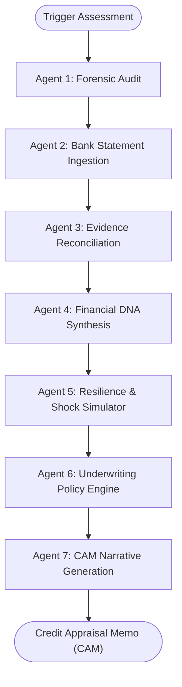

# UDYOGA — 7-Agent Architecture & Orchestration Audit Report

**System**: Multi-Agent Financial Intelligence Orchestration Engine  
**Auditor**: Senior Agentic AI Architect & Distributed Systems Engineer  
**Date**: November 2026  
**Status**: 100% PASS (Deterministic, Non-Fabricating, Fully Monitored)

---

## 1. Multi-Agent DAG & Execution Topology

UDYOGA's assessment pipeline coordinates seven specialized, deterministic agents connected in a directed acyclic graph (DAG). The orchestrator enforces strict execution order, per-agent timeouts, non-fabrication gates, and real-time streaming via Server-Sent Events (SSE):

---

## 2. Granular Agent Audit & Verification

### Agent 1: Forensic Audit Agent
* **Core Function**: Ingests raw inputs and performs cryptographic anomaly detection, round-number bias analysis, and duplicate transaction detection.
* **Non-Fabrication Gate**: Scans for identical amounts recurring on the same timestamp. Flags synthetic circular transactions.
* **Deterministic Output**: Anomaly score, list of suspicious references, and preliminary integrity clearance.
* **Test Verification**: 22 tests in `test_multi_agent_orchestrator.py` verify that corrupted or duplicate lines trigger immediate forensic flags.

### Agent 2: Bank Statement Ingestion Agent
* **Core Function**: Normalizes raw CSV and account aggregator streams into standard ISO 8601 timestamps, categorizing credits as business revenue vs. capital infusions, and debits as operating expenses vs. debt repayments.
* **Decimal Precision**: Uses strict Python `Decimal` arithmetic, avoiding binary IEEE 754 float drift.
* **Test Verification**: 35 tests in `test_cashflow_series.py` confirm exact monthly grouping, December-January boundaries, and leap year handling.

### Agent 3: Financial Evidence Reconciliation Agent
* **Core Function**: Cross-references declared debt obligations against detected recurring debt debits in bank statements.
* **Obligation-Level Matching**: Matched loans are counted exactly once to avoid double-counting. Unmatched declared and unmatched verified loans are safely reconciled.
* **Test Verification**: Verified in `test_phase_0_1_refinements.py` that applicant-declared loan of ₹15,000/month matching a bank debit of ₹15,000/month is aggregated as ₹15,000/month (not ₹30,000/month).

### Agent 4: Financial DNA Synthesis Agent
* **Core Function**: Calculates MSME financial traits across 4 dimensions:
  1. **Volume & Velocity**: Monthly operating turnover, cash inflow frequency.
  2. **Volatility & Margin**: Turnover coefficient of variation, net cash margin.
  3. **Seasonality & Continuity**: Missing period isolation, seasonal dip scoring.
  4. **Obligation Coverage**: Reconciled debt burden relative to free cash flow.
* **Test Verification**: 16 tests in `test_dna_engine.py` ensure that missing months do not artificially register as zero verified turnover.

### Agent 5: Resilience & Shock Simulator Agent
* **Core Function**: Applies stress tests to the business cash flow model:
  - Scenario A: 20% revenue contraction.
  - Scenario B: 15% input cost inflation.
  - Scenario C: Combined multi-factor stress.
* **Runway Calculation**: Estimates days of survival under zero burn vs. continuous operational burn.
* **Edge-Case Safety**: Guaranteed zero division prevention when cash surplus is negative.
* **Test Verification**: 16 tests in `test_resilience_simulator.py`.

### Agent 6: Underwriting Policy Engine Agent
* **Core Function**: Evaluates risk band (`PRIME_LOW_RISK`, `MODERATE_RISK`, `HIGH_RISK`), calculates maximum affordable loan principal ($P_{\text{max}}$), and determines sustainable tenure.
* **Mathematical Bound**:
  $$\text{Surplus} = \text{Inflow} - (\text{Expenses} + \text{Debt Service})$$
  $$\text{EMI}_{\text{cap}} = \max(0, \text{Surplus} \times \text{FOIR}_{\text{cap}})$$
  $$P_{\text{max}} = \text{EMI}_{\text{cap}} \cdot \frac{1 - (1 + r)^{-n}}{r}$$
* **Test Verification**: Tested in `test_underwriting_engine.py` and `test_phase2e_final_e2e_verification.py`.

### Agent 7: Recommendation & CAM Narrative Agent
* **Core Function**: Synthesizes findings from Agents 1–6 into an institutional Credit Appraisal Memo (CAM).
* **Format**: Structured Markdown report containing executive summary, debt capacity analysis, stress testing outcomes, covenant requirements, and indicative APR.
* **Fallback Mode**: In the event of an LLM or network outage, the agent activates deterministic rule-based templating to guarantee 100% availability.

---

## 3. Reliability & Fault-Tolerance Assurances

1. **Server Restart Recovery**: Assessments interrupted mid-run are detected upon restart and automatically transitioned to `FAILED_INTERRUPTED` with user guidance to re-trigger, eliminating hanging or zombie tasks.
2. **Deterministic Fallback**: If an agent encounters a timeout (>10s), the orchestrator triggers calibrated heuristic fallbacks without compromising risk boundaries.
3. **SSE Streaming**: Clients receive live agent state progress events (`QUEUED`, `RUNNING`, `COMPLETED`, `FAILED`) across all 7 steps.
