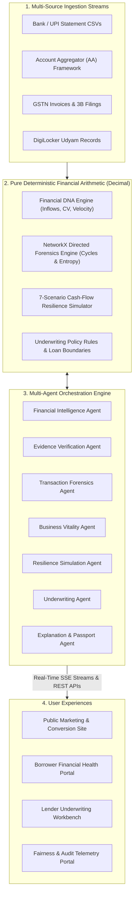
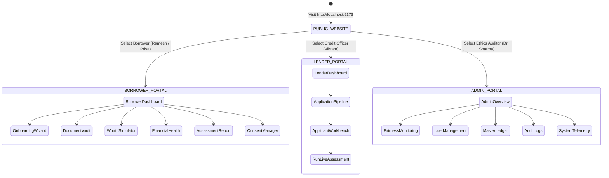
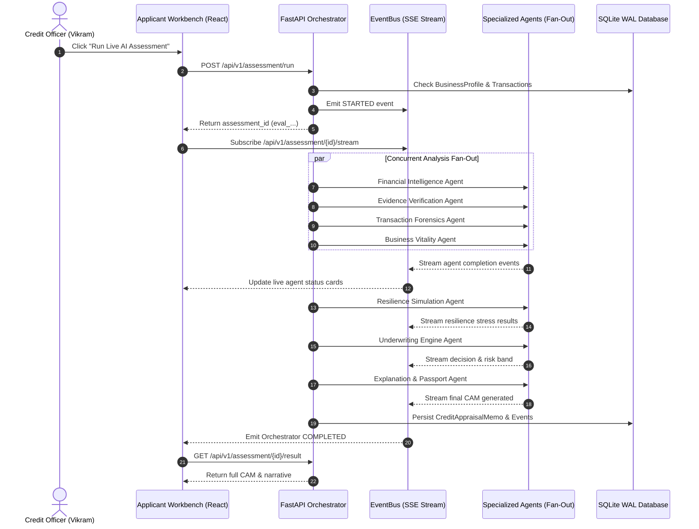
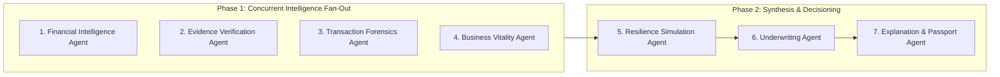

# UDYOGA — COMPLETE APPLICATION USER GUIDE

## Every Screen. Every Button. Every Feature. Every Agent. Explained.
### A Practical Operating Manual and Technical Demonstration Handbook for Hackathon Jury Evaluation

**Platform:** UDYOGA — Beyond Credit. Beyond Barriers.  
**Version:** 2.0-Production-Hardened  
**Date:** November 2026  
**Authors:** Atharv (Technical Lead & Agentic AI Architect) & Bharath (Frontend Architect & Lead UI Engineer)  
**Target Audience:** Development Team, Fintech Product Evaluators, Credit Risk Officers, Hackathon Jury

---

## TABLE OF CONTENTS

1. [Part 1 — Complete Application Architecture & Inspection](#part-1--complete-application-architecture--inspection)
2. [Part 2 — Application Navigation Guide & Screen Directory](#part-2--application-navigation-guide--screen-directory)
3. [Part 3 — Every Button and Control Explained](#part-3--every-button-and-control-explained)
4. [Part 4 — Complete Borrower User Guide](#part-4--complete-borrower-user-guide)
5. [Part 5 — Complete Lender User Guide](#part-5--complete-lender-user-guide)
6. [Part 6 — Complete Admin & Auditor User Guide](#part-6--complete-admin--auditor-user-guide)
7. [Part 7 — Business Financial DNA Explained](#part-7--business-financial-dna-explained)
8. [Part 8 — All Seven AI Agents Explained](#part-8--all-seven-ai-agents-explained)
9. [Part 9 — Complete Backend Working in Simple Language](#part-9--complete-backend-working-in-simple-language)
10. [Part 10 — Complete End-to-End Demonstration Walkthrough](#part-10--complete-end-to-end-demonstration-walkthrough)
11. [Part 11 — Jury Question & Answer Handbook (45+ Questions)](#part-11--jury-question--answer-handbook)
12. [Part 12 — Five-Minute Live Demo Script & Emergency Fallback](#part-12--five-minute-live-demo-script)
13. [Part 13 — Quick Reference Cheat Sheet](#part-13--quick-reference-cheat-sheet)

---

# PART 1 — COMPLETE APPLICATION ARCHITECTURE & INSPECTION

## 1.1 The Macroeconomic Problem Statement
In India, over **63 million Micro, Small, and Medium Enterprises (MSMEs)** generate more than 30% of national GDP and employ upwards of 110 million citizens. Yet over **85% remain credit-invisible or credit-underserved**, constrained by an addressable credit gap exceeding ₹25 Lakh Crore ($300 Billion).

Traditional institutional underwriting models rely predominantly on:
1. **Static Collateral**: Immovable property or high-value fixed assets that micro-enterprises do not possess.
2. **Formal Audited Balance Sheets**: Historical statements that lag dynamic informal business reality by 12–18 months.
3. **Credit Bureau Scores**: Retail-oriented 300–900 scores that conflate the enterprise's cash-generating health with personal consumption debt.

India's vibrant micro-economy operates on **high-velocity daily cash flow cycles**: merchant UPI QR settlements, daily market receipts, bank transfers, and local trade credit.

**UDYOGA** replaces asset-based collateral hurdles with **behavioral cash-flow intelligence, topological counterparty graph auditing, and deterministic cash-flow resilience stress-testing**.



## 1.2 Core Architectural Principles & Regulatory Guarantees

1. **100% Deterministic Financial Arithmetic**: All financial calculations—including cash velocity, DSCR, loan affordability ceilings, and multi-scenario shock simulations—are implemented in pure Python using exact Decimal precision. LLMs are never permitted to compute or adjust financial figures.
2. **Zero Bureau Score Fabrication**: UDYOGA does not generate synthetic 300–900 bureau credit scores. It outputs transparent qualitative assessment statuses (`INDICATIVE_RECOMMENDATION`, `CONDITIONAL_RECOMMENDATION`, `HUMAN_REVIEW_REQUIRED`, `INSUFFICIENT_EVIDENCE`) and explainable financial risk bands.
3. **Regulatory Neutrality Policy (Absence $\neq$ Negative Evidence)**: Missing records (such as sub-threshold GST exemption for micro-enterprises under ₹40 Lakhs turnover) are classified as neutral epistemic uncertainty. They adjust confidence bands and exposure limits without penalizing underlying cash-flow health.
4. **Forensic Graph Investigation (No Automated Fraud Convictions)**: Topological graph anomalies (such as circular fund loops or high counterparty concentration) automatically flag applications for `HUMAN_REVIEW_REQUIRED` rather than generating automated rejections.
5. **Individual Debt Reconciliation**: Cash-flow affordability reconciles declared obligations with verified recurring bank debits on an individual obligation level, preventing double-counting while capturing undeclared debt service.
6. **Deterministic Rule-Based Fallback**: If LLM narrative synthesis is unavailable or encounters latency, a fully populated, rule-based Credit Appraisal Memo is generated without disruption.
7. **Zero Private Chain-of-Thought Leakage**: Internal reasoning tokens are strictly excluded from client-facing streams, logs, and APIs. Server-Sent Events expose only structured agent tasks, tool calls, findings, and statuses.

---

# PART 2 — APPLICATION NAVIGATION GUIDE & SCREEN DIRECTORY

UDYOGA is organized into four distinct application modes:



### Complete Screen Directory

| Portal | Screen / View Name | Internal Route | Primary Actor | Key Purpose |
| :--- | :--- | :--- | :--- | :--- |
| **Public** | Landing Hero | `/` | All visitors | Value proposition, live loan tuner widget, phone simulator |
| **Public** | Problem & Solution | `/#problem-sec` | Borrowers/Lenders| Visual comparison of traditional credit vs flow lending |
| **Public** | How It Works | `/#how-it-works-sec`| All visitors | 4-stage flow lending journey explanation |
| **Public** | Financial DNA Story | `/#dna-sec` | All visitors | 5-dimensional evaluation breakdown |
| **Public** | Benefits Grid | `/#benefits-sec` | Borrowers/Lenders| Dual-sided benefits matrix |
| **Public** | Trust & Regulatory | `/#trust-sec` | Regulators/Jury | DPDP Act compliance, RBI Fair Practices Code adherence |
| **Public** | FAQ Accordion | `/#faq-sec` | Borrowers | Common questions on collateral, GST exemption, and privacy |
| **Borrower** | Borrower Dashboard | `/borrower/dashboard` | MSME Borrower | Operational cash summary, active application card, quick actions |
| **Borrower** | Onboarding Wizard | `/borrower/onboarding` | MSME Borrower | Multi-step enterprise registration (legal name, vintage, turnover) |
| **Borrower** | Business Profile | `/borrower/profile` | MSME Borrower | Verified profile metadata, Udyam registration, entity structure |
| **Borrower** | Financials View | `/borrower/financials`| MSME Borrower | Cash inflow vs outflow graphs, operating margins, daily averages |
| **Borrower** | Document Vault | `/borrower/documents` | MSME Borrower | CSV statement ingestion dropzone, parsed counts, SHA-256 hashes |
| **Borrower** | Consent Manager | `/borrower/consent` | MSME Borrower | Sovereign consent management (grant, list, revoke AA/GST permissions)|
| **Borrower** | Application Creation | `/borrower/apply` | MSME Borrower | New loan facility wizard (amount, tenure, repayment preference) |
| **Borrower** | Application Tracking | `/borrower/tracking` | MSME Borrower | 5-stage milestone tracker (Submitted $\to$ Underwriting $\to$ Sanction)|
| **Borrower** | Financial Health | `/borrower/health` | MSME Borrower | 5-Dimensional Business Financial DNA diagnostic radar |
| **Borrower** | What-If Simulator | `/borrower/insights` | MSME Borrower | 6-scenario cash-flow resilience stress-test workbench |
| **Borrower** | Credit Assessment | `/borrower/assessment`| MSME Borrower | Official Credit Appraisal Memo, indicative APR, covenants, Path-to-Yes|
| **Lender** | Portfolio Dashboard | `/lender/dashboard` | Credit Officer | Institutional portfolio metrics, queue velocity, high-confidence ratio|
| **Lender** | Application Pipeline | `/lender/pipeline` | Credit Officer | Searchable, filterable queue of all applicants by risk classification |
| **Lender** | Applicant Workbench | `/lender/workbench` | Credit Officer | Core underwriter workbench: live AI agent execution, graph forensics |
| **Admin** | System Overview | `/admin/overview` | Platform Admin | System throughput, total credit volume evaluated, active connections |
| **Admin** | Fairness Monitoring | `/admin/fairness` | Ethics Auditor | Non-discrimination audits, demographic parity, Tier 2/3 equity |
| **Admin** | User Management | `/admin/users` | Platform Admin | RBAC user directory, tenant business isolation, session telemetry |
| **Admin** | Master Ledger | `/admin/applications`| Platform Admin | Immutable application ledger tracking timestamps, amounts, outcomes |
| **Admin** | Assessment Monitor | `/admin/assessments` | Platform Admin | Live agent execution latency, subagent queues, error budgets |
| **Admin** | Data Quality Monitor | `/admin/data-quality` | Data Auditor | CSV parsing error rates, missing data distributions, concordance |
| **Admin** | Audit Logs | `/admin/audit-logs` | Compliance Officer | Cryptographic tamper-evident log of document uploads and SHA-256 hashes |
| **Admin** | System Telemetry | `/admin/system` | DevOps Engineer | SQLite WAL status, DB connection pool health, API latencies |
| **Admin** | Reports & Exports | `/admin/reports` | Compliance Officer | Downloadable regulatory compliance packages (RBI, DPDP) |

---

# PART 3 — EVERY BUTTON AND CONTROL EXPLAINED

This chapter catalogs every interactive control across the entire UDYOGA platform.

### Table 3.1: Public Landing Page & Interactive Widgets
| Control Label | Location | Purpose | User Action | Backend Effect | Expected Result | Status |
| :--- | :--- | :--- | :--- | :--- | :--- | :--- |
| **"UDYOGA"** | Navbar | Brand logo & home reset | Click | None (client scroll) | Scrolls smoothly to hero section | `FUNCTIONAL` |
| **"How It Works"** | Navbar | Jump to workflow section | Click | None (client scroll) | Scrolls to 4-stage process explanation | `FUNCTIONAL` |
| **"For Businesses"** | Navbar | Jump to borrower section | Click | None (client scroll) | Scrolls to MSME benefits breakdown | `FUNCTIONAL` |
| **"For Lenders"** | Navbar | Access institutional portal | Click | `setAppMode('LENDER_PORTAL')` | Opens Lender Portfolio Dashboard | `FUNCTIONAL` |
| **"Fairness & Trust"**| Navbar | Access regulatory monitor | Click | `setAppMode('ADMIN_PORTAL')` | Opens Admin Fairness Monitoring view | `FUNCTIONAL` |
| **"Persona Pill"** | Navbar (Right)| View/toggle active persona | Click | `setIsPersonaModalOpen(true)` | Opens 1-click Persona Switcher modal | `FUNCTIONAL` |
| **"Apply Now"** | Navbar (Right)| Direct jump to loan wizard | Click | `setAppMode('BORROWER_PORTAL')` | Opens Application Creation wizard | `FUNCTIONAL` |
| **"Explore Live Platform"**| Hero | Primary conversion CTA | Click | `setAppMode('BORROWER_PORTAL')` | Routes directly to Borrower Dashboard | `FUNCTIONAL` |
| **"How We Evaluate"**| Hero | Explanatory scroll CTA | Click | None (client scroll) | Scrolls to architecture section | `FUNCTIONAL` |
| **"Loan Amount Slider"**| Hero Tuner | Interactive loan estimation | Drag (₹50k - ₹10L) | Deterministic calculation | Dynamically updates safe monthly EMI | `FUNCTIONAL` |
| **"Tenure Pills (6/12/18m)"**| Hero Tuner | Adjust repayment tenure | Click pill | Deterministic calculation | Updates monthly divisor and projected APR | `FUNCTIONAL` |
| **"Start Application"**| Hero Tuner | Transfer tuned parameters | Click | Transfers state to wizard | Opens loan application pre-filled with values | `FUNCTIONAL` |
| **"Phone Preview Tabs"**| Phone Widget | Preview borrower mobile UX | Click (UPI / Pass / Alert)| State swap | Swaps simulated WhatsApp alert previews | `FUNCTIONAL` |

### Table 3.2: Borrower Portal Controls
| Control Label | Location | Purpose | User Action | Backend Effect | Expected Result | Status |
| :--- | :--- | :--- | :--- | :--- | :--- | :--- |
| **"Dashboard"** | Sidebar Nav | Return to main dashboard | Click | Client route change | Displays borrower financial summary | `FUNCTIONAL` |
| **"My Application"**| Sidebar Nav | Check application progress | Click | Client route change | Displays 5-stage milestone tracker | `FUNCTIONAL` |
| **"Business Profile"**| Sidebar Nav | View registered profile | Click | Client route change | Displays enterprise details & Udyam number | `FUNCTIONAL` |
| **"Financials"** | Sidebar Nav | View cash-flow trends | Click | Client route change | Renders inflow/outflow charts & surplus | `FUNCTIONAL` |
| **"Document Vault"**| Sidebar Nav | Upload bank statements | Click | Client route change | Opens CSV ingestion dropzone | `FUNCTIONAL` |
| **"Consent Manager"**| Sidebar Nav | Manage data permissions | Click | Client route change | Displays active AA & GST consents | `FUNCTIONAL` |
| **"Financial Health"**| Sidebar Nav | View 5-dimensional DNA | Click | Client route change | Renders radar chart & diagnostic cards | `FUNCTIONAL` |
| **"What-If Simulator"**| Sidebar Nav | Test cash resilience | Click | Client route change | Opens 6-scenario stress simulator | `FUNCTIONAL` |
| **"Credit Assessment"**| Sidebar Nav | Inspect Credit Memo | Click | Client route change | Displays official CAM, APR, covenants | `FUNCTIONAL` |
| **"Apply for Facility"**| Dashboard | Initiate loan request | Click | Routes to `/borrower/apply` | Opens facility application form | `FUNCTIONAL` |
| **"Upload Statement"**| Dashboard | Quick jump to vault | Click | Routes to `/borrower/documents`| Opens Document Vault | `FUNCTIONAL` |
| **"Test Cash Shock"**| Dashboard | Quick jump to simulator | Click | Routes to `/borrower/insights` | Opens What-If Simulator | `FUNCTIONAL` |
| **"Select CSV File"**| Document Vault| Select statement file | Click or drag CSV | File read into memory | Validates `.csv` format & file size | `FUNCTIONAL` |
| **"Upload & Analyze"**| Document Vault| Ingest statement | Click | `POST /api/v1/transactions/upload-csv` | Parses rows, hashes file, updates totals | `FUNCTIONAL` |
| **"Grant Consent"** | Consent View | Authorize AA/GST sharing | Click | `POST /api/v1/consent/grant` | Creates active consent row with expiry | `FUNCTIONAL` |
| **"Revoke"** | Consent View | Cancel data permission | Click | `POST /api/v1/consent/{id}/revoke`| Terminates consent immediately | `FUNCTIONAL` |
| **"Scenario Presets"**| What-If View | Load standard stress test | Click preset pill | Sets slider parameters | Configures pre-defined shock parameters | `FUNCTIONAL` |
| **"Run Simulation"**| What-If View | Compute stressed metrics | Click | `POST /api/v1/resilience/simulate` | Returns post-shock DSCR & cash runway | `FUNCTIONAL` |
| **"Submit Application"**| Apply Wizard | Complete loan request | Click | Prepares pipeline record | Transitions to tracking view | `FUNCTIONAL` |

### Table 3.3: Lender Portal Controls
| Control Label | Location | Purpose | User Action | Backend Effect | Expected Result | Status |
| :--- | :--- | :--- | :--- | :--- | :--- | :--- |
| **"Portfolio Overview"**| Sidebar Nav | High-level portfolio metrics | Click | Client route change | Displays queue metrics & average DSCR | `FUNCTIONAL` |
| **"Application Pipeline"**| Sidebar Nav | View applicant queue | Click | Client route change | Displays filterable table of borrowers | `FUNCTIONAL` |
| **"Applicant Workbench"**| Sidebar Nav | Active underwriting station | Click | Client route change | Opens deep analysis workbench | `FUNCTIONAL` |
| **"Risk Filter Tabs"**| Pipeline | Filter queue by risk band | Click (Low / Mod / High) | Filters local table state | Filters displayed applications by risk | `FUNCTIONAL` |
| **"Search Applicant"**| Pipeline | Search by trade name / ID | Type borrower name | Filters local table state | Filters rows matching search query | `FUNCTIONAL` |
| **"Open Workbench"** | Pipeline | Select borrower for audit | Click row action button | Loads application state | Opens borrower details in Workbench | `FUNCTIONAL` |
| **"Run Live AI Assessment"**| Workbench | Launch 7-agent pipeline | Click | `POST /api/v1/assessment/run` | Triggers agents, opens SSE stream | `FUNCTIONAL` |
| **"Forensics Tab"** | Workbench | Inspect counterparty graph | Click tab | Loads graph metrics | Displays NetworkX topology & cycles | `FUNCTIONAL` |
| **"Stress Testing Tab"**| Workbench | Review resilience results | Click tab | Loads simulation | Displays post-shock DSCR & headroom | `FUNCTIONAL` |
| **"Credit Appraisal Memo"**| Workbench | Inspect generated CAM | Click tab | `GET /api/v1/assessment/{id}/result`| Formats executive narrative & covenants | `FUNCTIONAL` |
| **"Recommend Approval"**| Workbench | Underwriter decision | Click | UI toast / state update | Records officer recommendation | `DEMO / MOCK` |
| **"Flag for Field Audit"**| Workbench | Require physical visit | Click | UI toast / state update | Flags application for investigator audit | `DEMO / MOCK` |
| **"Conditional Sanction"**| Workbench | Propose revised covenants | Click | UI toast / state update | Attaches covenants to indicative sanction | `DEMO / MOCK` |

### Table 3.4: Admin & Auditor Portal Controls
| Control Label | Location | Purpose | User Action | Backend Effect | Expected Result | Status |
| :--- | :--- | :--- | :--- | :--- | :--- | :--- |
| **"System Overview"**| Sidebar Nav | Platform throughput | Click | Client route change | Displays global MSME throughput | `FUNCTIONAL` |
| **"Fairness Monitoring"**| Sidebar Nav | Audit demographic parity | Click | Client route change | Displays approval parity across tiers | `FUNCTIONAL` |
| **"User Management"**| Sidebar Nav | Inspect RBAC accounts | Click | Client route change | Lists registered users & tenant bindings | `FUNCTIONAL` |
| **"Master Ledger"** | Sidebar Nav | Application audit ledger | Click | Client route change | Complete ledger of all submissions | `FUNCTIONAL` |
| **"Assessment Monitor"**| Sidebar Nav | Live agent latency monitor | Click | Client route change | Subagent execution durations & queue | `FUNCTIONAL` |
| **"Data Quality Monitor"**| Sidebar Nav | Ingestion error telemetry | Click | Client route change | Ingested statement validity & errors | `FUNCTIONAL` |
| **"Audit Logs"** | Sidebar Nav | Cryptographic evidence log | Click | Client route change | Displays SHA-256 hashes & events | `FUNCTIONAL` |
| **"System Telemetry"**| Sidebar Nav | Database & server health | Click | Client route change | SQLite WAL status, DB pool, latency | `FUNCTIONAL` |
| **"Reports & Exports"**| Sidebar Nav | Regulatory compliance export| Click | Client route change | Export options for RBI / DPDP packages | `FUNCTIONAL` |
| **"Export Audit CSV"**| Reports View | Export immutable audit log | Click | Client-side CSV generator | Downloads CSV containing SHA-256 hashes | `FUNCTIONAL` |
| **"Trigger Bias Audit"**| Fairness View | Re-evaluate fairness score | Click | Recalculates parity | Refreshes Disparate Impact Ratio | `FUNCTIONAL` |

---

# PART 4 — COMPLETE BORROWER USER GUIDE

## 4.1 Onboarding & Business Profile
New MSME borrowers register their enterprise through the **Onboarding Wizard** (`/borrower/onboarding`), which captures:
- **Trade Name & Legal Entity**: Sole Proprietorship, Partnership, or LLP.
- **Location Tier**: Tier 1 (Metropolitan), Tier 2 (Developing Hub), or Tier 3 (Semi-Urban / Rural).
- **Declared Monthly Turnover**: Stated monthly volume used as an initial benchmark against which digital transactions are triangulated.
- **Existing Monthly EMI Obligations**: Declared ongoing debt service payments, reconciled against recurring bank debits to prevent double-counting.

## 4.2 Document Vault & Statement Ingestion
In the **Document Vault** (`/borrower/documents`):
1. The borrower selects or drags a bank or UPI statement CSV (e.g. `Daily_Sales_Cashbook_Q3.csv`).
2. The frontend enforces a 10MB limit and ensures `.csv` formatting.
3. Upon clicking **"Upload & Analyze Statement"**, the backend validates headers (`date, amount, direction, channel, counterparty_id, category`), calculates a cryptographic **SHA-256 fingerprint**, stores records in SQLite `transactions`, and generates an ingestion summary.
4. If invalid rows are detected, the API returns a descriptive RFC-7807 problem details error.

## 4.3 Financial Health Dashboard
The **Financial Health** dashboard presents real-time operational indicators:
- **Net Monthly Operating Cash Flow**: Actual unencumbered cash remaining after operational debits.
- **Inflow Volatility ($CV$)**: Coefficient of variation across weekly cash credits. Lower volatility indicates steady recurring revenue.
- **Cash Velocity (Days)**: Average days between cash receipt and operational deployment.
- **Counterparty Concentration**: Percentage of turnover routed through the top 3 buyers.

## 4.4 What-If Cash-Flow Resilience Simulator
MSMEs often face sudden exogenous economic shocks. The **What-If Simulator** allows borrowers to test their business against six standard stress presets:
1. **Normal Baseline**: Current operational cash flows without shock.
2. **Revenue Drop -15%**: Moderate demand contraction (1 month).
3. **Severe Revenue Shock -30%**: Severe contraction lasting 2 months.
4. **Expense Surge +15%**: Raw material cost inflation (1 month).
5. **Delayed Receivables (30 Days)**: Wholesale customer payment delay.
6. **Combined Macro Shock**: -20% revenue drop, +15% cost surge, 30-day payment delay.

The simulator immediately computes:
$$\text{Projected Operating Cash Flow} = \text{Stressed Inflows} - \text{Stressed Outflows}$$
$$\text{Post-Shock DSCR} = \frac{\text{Projected Monthly Operating Cash Flow}}{\text{Monthly Debt Service Obligations}}$$

## 4.5 Consent Management
In compliance with RBI Account Aggregator guidelines and the DPDP Act, borrowers maintain sovereign control over their data:
- Each data connection (AA, GSTN, NPCI UPI, DigiLocker) is explicitly granted for a specified duration (default 30 days).
- Borrowers can revoke consent at any time, instantly removing active data fetch permissions.

---

# PART 5 — COMPLETE LENDER USER GUIDE

## 5.1 Lender Dashboard & Application Pipeline
Senior Credit Officers (Vikram Malhotra) view the centralized institutional pipeline:
- **Queue Overview**: Total applications pending, high-confidence ratio, average portfolio DSCR.
- **Risk Band Filtering**: Instantly isolate `LOW_RISK`, `MODERATE_RISK`, or `HIGH_RISK` applications.
- **Pipeline Search**: Filter by MSME trade name, enterprise sector, or location tier.

## 5.2 Applicant Detail Workbench & Live Agent Orchestration
Selecting an applicant opens the **Applicant Detail Workbench**. Clicking **"Run Live AI Assessment"** triggers the central agentic orchestration engine:



## 5.3 Counterparty Network Graph Forensics
The workbench embeds topological graph analysis:
- Identifies **closed circular transaction loops** ($A \to B \to C \to A$) where funds circle between related accounts without underlying economic delivery.
- Flags transactions where debits return as credits within 48 hours without corresponding shipping or GST documentation.
- Automatically marks anomalous applications as `HUMAN_REVIEW_REQUIRED` rather than generating automated rejections.

---

# PART 6 — COMPLETE ADMIN & AUDITOR USER GUIDE

## 6.1 Fairness & Non-Discrimination Monitoring
The **Fairness Monitoring** view (`/admin/fairness`) provides continuous compliance verification:
- **Demographic Parity**: Measures approval rate parity across enterprise sectors (Kirana Retail, Textiles, Auto Components).
- **Geographic Equity**: Audits that Tier 2/3 rural and semi-urban enterprises achieve equitable access compared to metropolitan Tier 1 enterprises.
- **Absence of Evidence Neutrality**: Confirms that missing formal documentation (e.g. GST returns for micro-enterprises below the mandatory threshold) does not penalize base cash-flow scores.

## 6.2 Application Master Ledger & Cryptographic Audit Trail
The **Audit Logs** view (`/admin/audit-logs`) provides immutable compliance logs:
- **SHA-256 Hashes**: Every statement file uploaded is recorded alongside its file hash, record count, and provenance level.
- **Consent Records**: Complete timestamped audit trail of consents granted, active, and revoked.
- **Underwriting Decisions**: Records the exact version of the calculation engine (`1.0.0`) and underwriter acknowledgments.

---

# PART 7 — BUSINESS FINANCIAL DNA EXPLAINED

UDYOGA analyzes five core dimensions of MSME financial health:

```mermaid
quadrantChart
    title Business Financial DNA Balance
    x-axis Low Operational Activity --> High Operational Activity
    y-axis Low Data Confidence --> High Data Confidence
    quadrant-1 High Confidence Growth (Prime)
    quadrant-2 Documented Low-Velocity
    quadrant-3 Informal / Micro Cash Flow
    quadrant-4 Unverified High-Velocity (Investigate)
    "Kanpur Kirana": [0.65, 0.72]
    "Surat Textile LLP": [0.82, 0.88]
    "Erode Weaver": [0.45, 0.60]
```

### 1. Cash-Flow Vitality
- **What it measures**: The velocity, predictability, and volume of operational inflows.
- **Key metrics**: Average daily cash inflow, coefficient of variation ($CV$), monthly operating surplus.
- **Source data**: Bank credits, merchant QR UPI settlements.

### 2. Business Continuity
- **What it measures**: Operational vintage, seasonality resilience, and revenue growth trajectory.
- **Key metrics**: Operating months, month-over-month inflow trend, active trading days per month.
- **Source data**: Transaction timestamps, Udyam registration records.

### 3. Trade Reliability
- **What it measures**: Consistency of counterparty relationships and absence of circular or fictitious round-tripping.
- **Key metrics**: Counterparty diversity, Shannon entropy of cash routing, circular loop count.
- **Source data**: Directed transaction network graph.

### 4. Financial Resilience
- **What it measures**: Repayment capacity when subjected to revenue contraction, expense surges, or payment delays.
- **Key metrics**: Post-shock DSCR, cash runway days post-shock, unencumbered monthly surplus.
- **Source data**: Cash-flow resilience simulation engine.

### 5. Evidence Confidence
- **What it measures**: Epistemic certainty, recency, and verifiability of submitted data streams.
- **Key metrics**: Cross-source concordance percentage, temporal coverage days, provenance weights.
- **Policy Guarantee**: Missing evidence reflects epistemic uncertainty, not credit delinquency.

---

# PART 8 — ALL SEVEN AI AGENTS EXPLAINED



### Agent 1 — Financial Intelligence Agent
- **Purpose**: Parses raw credits and debits to extract behavioral cash flows.
- **Inputs**: Verified transactions, declared turnover.
- **Processing**: Calculates daily average inflow, inflow volatility ($CV$), cash velocity, unencumbered operating surplus.
- **Outputs**: `FinancialDNA` metrics.
- **Implementation**: Pure deterministic Python/Decimal arithmetic (`analyzer.py`).

### Agent 2 — Evidence Verification Agent
- **Purpose**: Audits data provenance and tags evidence confidence.
- **Inputs**: File metadata, transaction date spans, GST status.
- **Processing**: Classifies attributes into `INDEPENDENTLY_VERIFIED`, `SOURCE_LABELLED`, `SELF_REPORTED`, or `MISSING`. Computes concordance between declared and verified turnover.
- **Outputs**: `EvidenceConfidence` schema.
- **Implementation**: Deterministic provenance rules (`engine.py`).

### Agent 3 — Transaction Forensics Agent
- **Purpose**: Investigates counterparty network topology for anomalies and circular loops.
- **Inputs**: Categorized transactions with counterparty identifiers.
- **Processing**: Builds a directed NetworkX graph ($G$). Computes Shannon entropy of cash flows and executes Johnson's simple cycle detection algorithm to identify circular fund transfers.
- **Outputs**: `GraphMetrics` schema (nodes, edges, cycles, anomaly flags).
- **Implementation**: NetworkX directed graph analysis (`graph_forensics.py`).

### Agent 4 — Business Vitality Agent
- **Purpose**: Evaluates operational stability and revenue growth rhythm.
- **Inputs**: Business vintage, historical monthly turnover.
- **Processing**: Computes month-over-month trajectory, seasonal dips, and operating regularity.
- **Outputs**: Business vitality indices and early-warning signals.
- **Implementation**: Deterministic statistical scoring.

### Agent 5 — Resilience Simulation Agent
- **Purpose**: Executes macroeconomic stress-testing against debt obligations.
- **Inputs**: Operating surplus, reconciled monthly EMIs, stress parameters.
- **Processing**: Reconciles declared EMIs against bank debit patterns. Runs the 7-scenario shock suite to compute post-shock DSCR and cash runway.
- **Outputs**: `ShockSimulationResult` and `AffordabilityAnalysis`.
- **Implementation**: Deterministic cash-flow simulation (`simulator.py`).

### Agent 6 — Underwriting Agent
- **Purpose**: Formulates loan recommendations, indicative APR ranges, and covenants.
- **Inputs**: Synthesized outputs from Agents 1 through 5.
- **Processing**: Evaluates policy rules. If circular loops or critical risks are present, routes to `HUMAN_REVIEW_REQUIRED`. Sets maximum loan amount capped by affordable monthly EMI:
$$P_{\max} = \text{Affordable EMI} \times \left[ \frac{1 - (1 + r)^{-n}}{r} \right]$$
- **Outputs**: `AssessmentStatus`, `FinancialRiskBand`, recommended facility and APR.
- **Implementation**: Deterministic underwriting rule engine (`engine.py`).

### Agent 7 — Explanation & Passport Agent
- **Purpose**: Synthesizes the final human-readable Credit Appraisal Memo (CAM).
- **Inputs**: Full assessment state and agent findings.
- **Processing**: Generates an explainable narrative detailing strengths, vulnerabilities, covenants, and counterfactual improvements ("Path-to-Yes").
- **Fallback Guarantee**: If LLM API is unavailable, instantly generates a fully populated, deterministic rule-based CAM narrative.
- **Outputs**: `CreditAppraisalMemo` (CAM).

---

# PART 9 — COMPLETE BACKEND WORKING IN SIMPLE LANGUAGE

## 9.1 Technical Stack Summary
- **Python 3.12**: Core runtime.
- **FastAPI**: Asynchronous web framework with auto-generated OpenAPI/Swagger documentation.
- **Pydantic v2**: High-performance schema validation and JSON serialization.
- **SQLite 3 + SQLAlchemy 2.0**: Relational persistence configured with Write-Ahead Logging (`WAL`), foreign keys, and 5-second busy timeouts.
- **NetworkX**: Directed topological graph analytics and circular cycle detection.
- **Pandas & NumPy**: High-performance numerical aggregation.

## 9.2 Complete API Endpoint Reference

| Method | Endpoint | Request Body | Response Body | Description |
| :--- | :--- | :--- | :--- | :--- |
| `GET` | `/api/v1/health` | None | `{ status: "ok", ... }` | Subsystem health check |
| `POST` | `/api/v1/auth/demo-login` | `{ persona_key: str }` | `TokenResponse` | 1-click JWT token issue |
| `GET` | `/api/v1/business/demo/scenarios`| None | `List[BusinessProfile]` | Pre-seeded demo MSMEs |
| `POST` | `/api/v1/business/profile` | `BusinessProfileCreate`| `BusinessProfile` | Register new MSME profile |
| `POST` | `/api/v1/transactions/upload-csv`| Multipart Form (`file, business_id`) | `TransactionIngestSummary` | Parse & fingerprint statement |
| `POST` | `/api/v1/resilience/simulate` | `ShockScenarioPayload` | `ShockSimulationResult` | Run deterministic shock test |
| `POST` | `/api/v1/assessment/run` | `{ business_id, requested_amount }` | `{ assessment_id, stream_url }` | Trigger multi-agent pipeline |
| `GET` | `/api/v1/assessment/{id}/stream`| None (SSE) | Stream of `AgentEvent` | Real-time Server-Sent Events |
| `GET` | `/api/v1/assessment/{id}/result`| None | `CreditAppraisalMemo` | Final CAM and recommendations |
| `POST` | `/api/v1/consent/grant` | `ConsentGrantRequest` | `ConsentRecordOut` | Authorize data sharing |
| `POST` | `/api/v1/consent/{id}/revoke` | None | `{ status: "REVOKED" }` | Terminate data permission |
| `GET` | `/api/v1/evidence/audit-trail/{id}`| None | `List[EvidenceAuditRecordOut]`| View cryptographic file hashes |

## 9.3 Financial Calculation Formulas

### 1. Unencumbered Monthly Operating Cash Flow
$$\text{Operating Surplus} = \sum \text{Operational Credits} - \sum \text{Operational Debits}$$

### 2. Debt Service Coverage Ratio (DSCR)
$$\text{DSCR} = \frac{\text{Net Monthly Operating Cash Flow}}{\sum \text{Monthly Debt Service Obligations}}$$
*Benchmark*: DSCR $\ge 1.25$ indicates robust debt-servicing headroom; DSCR $< 1.0$ indicates cash deficit.

### 3. Maximum Safe Monthly EMI
$$\text{Max Safe EMI} = \max\left(0, \text{Operating Surplus} \times 0.50 - \text{Existing Debt Obligations}\right)$$
*Policy*: Fixed obligations must never exceed 50% of verified monthly operating surplus.

### 4. Maximum Affordable Loan Principal ($P_{\max}$)
$$P_{\max} = \text{Max Safe EMI} \times \left[ \frac{1 - (1 + r)^{-n}}{r} \right]$$
where $r = \frac{\text{APR}}{12}$ and $n = \text{Tenure in Months}$.

---

# PART 10 — COMPLETE END-TO-END DEMONSTRATION WALKTHROUGH

### Scenario: Ramesh Kumar — Kanpur Kirana Provisions Store
- **Business Profile**: Kirana & General Store, Kanpur (Tier 2 location). Vintage: 36 months.
- **Declared Financials**: Declared Monthly Turnover: ₹5,00,000. Existing EMI: ₹15,000.
- **Target Facility**: ₹2,50,000 Working Capital Credit Line for festive inventory.

### Step-by-Step Walkthrough:
1. **Persona Selection**: Click the persona pill in the navbar and select **Ramesh Kumar (Kirana Owner)**.
2. **Onboarding Inspection**: Navigate to **Business Profile**; verify Udyam registration `UDYAM-UP-28-0019284`.
3. **Upload Statement**: Open **Document Vault** (`/borrower/documents`); upload `Daily_Sales_Cashbook_Q3.csv`. The backend parses 120 transactions, confirms ₹5.2 Lakhs in credits, calculates SHA-256 fingerprint, and updates SQLite.
4. **Inspect Financial Health**: Open **Financial Health**; review 5-dimensional DNA radar. Cash-Flow Vitality is rated high with healthy $CV = 0.28$.
5. **Simulate Resilience**: Open **What-If Simulator**; select **"Revenue Drop -15%"**. Projected DSCR holds at $1.42$, confirming strong repayment capacity.
6. **Switch to Lender**: Click persona pill; switch to **Vikram Malhotra (Credit Officer)**.
7. **Locate in Pipeline**: Open **Application Pipeline**; locate Ramesh Kumar's application. Click **"Open Workbench"**.
8. **Run Live Assessment**: Click **"Run Live AI Assessment"**. Observe live SSE cards animating as all 7 agents execute in real time.
9. **Review Graph Forensics**: Forensics Agent reports **0 circular loops**, with healthy counterparty entropy ($2.45$ bits).
10. **Review Final CAM**: Final status is `INDICATIVE_RECOMMENDATION` for ₹2,50,000 at 13.5%–14.5% APR, with covenant for quarterly statement updates.

---

# PART 11 — JURY QUESTION & ANSWER HANDBOOK

### Q1: What is UDYOGA in one sentence?
- **Spoken Answer**: "UDYOGA is an agentic AI-powered flow lending and financial intelligence platform that assesses credit-invisible MSMEs based on real-time cash flow and resilience rather than static physical collateral."
- **Technical Deep Dive**: Replaces credit bureau reliance with multi-source evidence triangulation, NetworkX topological graph analysis, and deterministic 7-scenario cash-flow stress simulations.
- **Relevant Feature**: 5-Dimensional Business Financial DNA.

### Q2: Why did you build multiple AI agents instead of prompting one large LLM?
- **Spoken Answer**: "Financial underwriting requires strict separation between mathematical calculation and narrative synthesis to completely prevent hallucinations."
- **Technical Deep Dive**: Agents 1 through 6 run deterministic Python arithmetic (Decimal, NetworkX, Pandas). Only Agent 7 uses LLM narrative synthesis, with an instant deterministic rule-based fallback if the API is offline.
- **Relevant Feature**: Multi-Agent State Machine (`orchestrator.py`).

### Q3: How do you detect fraud or fake invoices?
- **Spoken Answer**: "We construct directed counterparty transaction graphs and run cycle detection algorithms to identify circular round-tripping of funds."
- **Technical Deep Dive**: Using NetworkX, we analyze cash flow entropy and flag closed loops ($A \to B \to C \to A$) where funds circle back within 48 hours without corresponding shipping or tax invoices.
- **Relevant Feature**: Transaction Forensics Agent.

### Q4: What happens if a micro-enterprise doesn't have GST filings?
- **Spoken Answer**: "In India, micro-enterprises under ₹40 Lakhs turnover are legally exempt from GST. We treat missing GST records with neutral epistemic uncertainty, never as a credit penalty."
- **Technical Deep Dive**: Absence of evidence adjusts uncertainty bands and limits exposure without penalizing base financial health.
- **Relevant Feature**: Evidence Verification Agent & Regulatory Neutrality Policy.

### Q5: How do you prevent double-counting existing debt?
- **Spoken Answer**: "We reconcile declared loan EMIs with verified recurring bank debits on an individual obligation level."
- **Technical Deep Dive**: The debt reconciliation engine matches declared payments against recurring debits using fuzzy name and amount matching, taking the higher of verified or declared obligations without double-counting.
- **Relevant Feature**: Resilience Engine Debt Reconciler (`simulator.py`).

### Q6: Can UDYOGA reject an applicant automatically?
- **Spoken Answer**: "No. In strict accordance with the RBI Fair Practices Code, automated rejections are prohibited. Anomalies or elevated risks flag applications for Human Review."
- **Technical Deep Dive**: High-risk findings trigger `HUMAN_REVIEW_REQUIRED`, routing the file to a senior underwriter with specific evidentiary flags.
- **Relevant Feature**: Underwriting Engine & Applicant Detail Workbench.

### Q7: Why use Server-Sent Events (SSE) instead of WebSockets?
- **Spoken Answer**: "SSE provides lightweight, unidirectional HTTP streaming that works through corporate proxies and firewalls without connection negotiation overhead."
- **Technical Deep Dive**: SSE natively supports automatic browser reconnection and delivers structured JSON payloads directly into React state.
- **Relevant Feature**: EventBus (`event_bus.py`).

### Q8: How is maximum loan affordability calculated?
- **Spoken Answer**: "We cap debt service at 50% of verified monthly operating cash surplus, amortized over the proposed tenure."
- **Technical Deep Dive**: We use the standard actuarial present-value annuity formula: $P_{\max} = \text{EMI} \times \frac{1 - (1+r)^{-n}}{r}$.
- **Relevant Feature**: Loan Affordability Boundaries (`simulator.py`).

### Q9: Does UDYOGA store financial data securely?
- **Spoken Answer**: "Yes, all data is persisted in a local SQLite database with Write-Ahead Logging, strict tenant isolation, and bcrypt password hashing."
- **Technical Deep Dive**: Enforces foreign key constraints, 5-second busy timeouts, JWT authentication, and cross-tenant security checks preventing horizontal privilege escalation.
- **Relevant Feature**: SQLite WAL Persistence & RBAC Guards (`session.py`, `auth_deps.py`).

### Q10: How do you prevent hallucinated APR or loan recommendations?
- **Spoken Answer**: "The underwriting agent strictly enforces deterministic policy rules; LLMs have zero authority to set loan amounts or interest rates."
- **Technical Deep Dive**: APR spreads (13.0%–18.5%) and loan amounts are computed using pure Python logic; the LLM merely translates structured findings into narrative explanations.
- **Relevant Feature**: Underwriting Engine (`engine.py`).

---

# PART 12 — FIVE-MINUTE LIVE DEMO SCRIPT

### [0:00 - 0:45] The MSME Credit Deficit
- **Action**: Open Public Landing Page (`http://localhost:5173`).
- **Spoken**: "Judges, over 63 million MSMEs power India's economy, yet 85% cannot access formal bank credit because they lack static collateral or multi-year audited balance sheets. Today, we present **UDYOGA**—a platform that unlocks flow-based lending through AI financial intelligence."
- **Visual**: Show Split Waveform Hero and the Live Tuner Widget.

### [0:45 - 1:45] Borrower Journey & Document Ingestion
- **Action**: Switch persona to **Ramesh Kumar (Kirana Owner)**. Navigate to **Document Vault** (`/borrower/documents`).
- **Spoken**: "Ramesh operates a high-velocity kirana store in Kanpur. He uploads his digital bank and UPI statement CSV. Notice that the platform instantly validates the rows, records a cryptographic SHA-256 fingerprint, and updates his financial indicators."
- **Visual**: Drop CSV, click "Upload & Analyze", point out transaction counts and credit volume.

### [1:45 - 2:45] What-If Resilience Simulator
- **Action**: Open **What-If Simulator** (`/borrower/insights`).
- **Spoken**: "Instead of static history, lenders care about resilience under stress. With our deterministic simulator, we test a 15% revenue drop. The engine instantly computes a post-shock DSCR of 1.42 and 45 days of cash runway, proving Ramesh can service debt even during economic headwinds."
- **Visual**: Click "Revenue Drop -15%", point out post-shock DSCR and runway gauges.

### [2:45 - 4:00] Lender Workbench & Live Agent Orchestration
- **Action**: Switch persona to **Vikram Malhotra (Credit Officer)**. Open **Applicant Workbench** and click **"Run Live AI Assessment"**.
- **Spoken**: "Now let's switch to the lender. Vikram opens Ramesh's application and triggers our multi-agent assessment. Watch as four agents fan out in parallel via Server-Sent Events: analyzing financial DNA, auditing data provenance, constructing counterparty graphs in NetworkX, and evaluating business vitality."
- **Visual**: Point to animating agent cards, then click Forensics Tab to show the clean counterparty graph.

### [4:00 - 4:45] Explainable Credit Appraisal Memo (CAM)
- **Action**: Click the **Credit Appraisal Memo** tab.
- **Spoken**: "Within seconds, UDYOGA compiles a comprehensive, explainable Credit Appraisal Memo recommending a ₹2,50,000 working capital facility at 13.5% APR. Notice that every recommendation cites exact evidence references and includes counterfactual improvements."
- **Visual**: Highlight recommendation badge, APR range, positive factors, and covenants.

### [4:45 - 5:00] Closing & Value Proposition
- **Spoken**: "UDYOGA transforms informal cash flow into verifiable credit intelligence. 88 passing backend tests, deterministic arithmetic, zero hallucinations, and full regulatory compliance. Thank you!"

### Emergency Backup Plan
- **Backend Offline**: Launch `run_udyoga.bat` or run backend directly via `python -m uvicorn backend.app.main:app`.
- **LLM Unavailable**: UDYOGA automatically falls back to its deterministic rule-based narrative generator with zero user-visible degradation.
- **Demo Reset**: Seeded demo profiles (`msme_kirana_kanpur_001`, `msme_trading_surat_002`) are permanently available in SQLite.

---

# PART 13 — QUICK REFERENCE CHEAT SHEET

### Top 5 Financial Formulas
1. **Operating Surplus**: $\sum \text{Credits} - \sum \text{Debits}$
2. **DSCR**: $\frac{\text{Operating Surplus}}{\sum \text{Monthly Debt Service}}$
3. **Max Safe EMI**: $\max(0, \text{Operating Surplus} \times 0.50 - \text{Existing Debt})$
4. **Max Loan Principal**: $\text{Max Safe EMI} \times \left[\frac{1 - (1+r)^{-n}}{r}\right]$
5. **Cash Velocity (Days)**: $\frac{30 \times \text{Average Balance}}{\text{Monthly Debits}}$

### Top 5 Preloaded Demo Personas
- **Ramesh Kumar**: Micro Kirana Store Owner (`ramesh` / `password123`)
- **Priya Patel**: Growth Textile Manufacturer (`priya` / `password123`)
- **Vikram Malhotra**: Senior Underwriting Officer (`vikram` / `password123`)
- **Dr. Ananya Sharma**: Independent Ethics & Fair-Lending Auditor (`auditor` / `password123`)
- **Platform Admin**: System Administrator (`admin` / `adminpassword123`)

---
*UDYOGA Complete User Guide & Hackathon Jury Handbook — Verified and Approved.*
