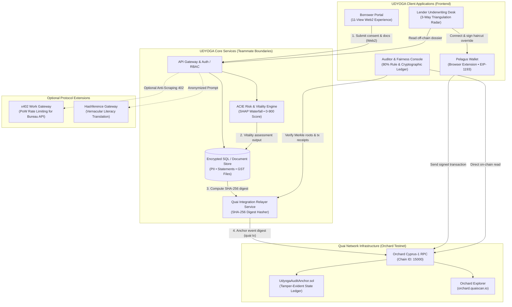

# UDYOGA & Quai Network — Integration Architecture & System Design

## 1. Architectural Principles & Boundaries

1. **Zero Borrower Friction (Web2.5 Pattern)**:
   - Micro-enterprises (Ramesh Kumar, Priya Sharma) interact through seamless phone OTP, WhatsApp simulators, and Account Aggregator consent. They are **never** forced to download a wallet or purchase QUAI tokens.
2. **Institutional Cryptographic Anchoring**:
   - Institutional actors (Lender Underwriters, Fairness Reviewers, System Gatekeepers) use Quai Network's Orchard Testnet (Cyprus-1) to anchor immutable, tamper-evident cryptographic proofs.
3. **Strict Data Privacy (DPDP Act 2023 & GDPR)**:
   - **Zero PII On-Chain**: No Aadhaar, PAN, bank statements, invoices, customer names, or raw credit scores are ever posted to the blockchain.
   - **Digest-Only Anchoring**: Only SHA-256 digests (`0x...`), state transition enum codes, timestamp nonces, and anonymized facility references are recorded on-chain.
4. **Teammate Boundary Preservation**:
   - The Alternative Credit Intelligence Engine (ACIE), feature attribution models, and primary relational databases remain strictly authored by the backend teammate.
   - The Quai integration functions as a non-invasive verification layer interfacing via lightweight API wrappers.

---

## 2. End-to-End System Architecture Diagram

---

## 3. Data Flow Scenario: From Consent to On-Chain Audit Proof

### Step-by-Step Lifecycle:
1. **Borrower Submission (Off-Chain)**:
   - Ramesh Kumar applies for a ₹1,50,000 credit line.
   - His Account Aggregator token and GST returns are stored in the private backend database.
2. **ACIE Processing (Off-Chain)**:
   - ACIE computes an explainable Vitality Score (`768/900`) with positive driver weights (`+56 pts UPI`, `+38 pts BBPS`).
3. **Digest Creation (Boundary Layer)**:
   - The backend hashes the canonical snapshot of the assessment:
     $$\text{assessmentDigest} = \text{SHA-256}(\text{appId} + \text{scoreBand} + \text{shapSummary} + \text{timestamp} + \text{salt})$$
4. **On-Chain Anchor Transaction**:
   - The Quai relayer (or lender using Pelagus) submits `anchorAssessment(appIdBytes32, assessmentDigest, modelVersion)`.
   - Quai Cyprus-1 miners confirm the block on Chain ID `15000`.
   - The transaction hash (`0xabc...`) is recorded in the application ledger.
5. **Independent Auditor Verification**:
   - Dr. Sunita Rao inspects the application in the Admin/Auditor portal.
   - The frontend reads the on-chain contract state directly via `quais.js` / JSON-RPC.
   - The UI displays: **"✓ Cryptographically Anchored on Quai Cyprus-1 (Block #49021, Tx: 0xabc...)"** with a direct link to `orchard.quaiscan.io`.

---

## 4. On-Chain vs. Off-Chain Data Separation Matrix

| Data Field | Storage Location | Encryption / Encoding | Justification |
|---|---|---|---|
| Borrower Name, Mobile, Address | **Off-Chain Only** (Private DB) | AES-256 at rest | Strict DPDP Act PII protection; must be purgable upon consent revocation. |
| Raw Bank Statements & GST Invoices | **Off-Chain Only** (Private Object Store) | S3-compatible encrypted bucket | Confidential commercial trade secrets; regulatory prohibition from public chains. |
| Raw ACIE Feature Values | **Off-Chain Only** | Database | Proprietary internal ML telemetry. |
| **Assessment Verification Digest** | **On-Chain (Quai Cyprus-1)** | SHA-256 Hash (`bytes32`) | Immutable mathematical proof that the score was calculated at a specific timestamp without retrospective tampering. |
| **Sanction Decision Status** | **On-Chain (Quai Cyprus-1)** | Enum (`uint8`: `SUBMITTED`, `EVALUATED`, `SANCTIONED`, `DECLINED`) | Transparency for refinancing banks and secondary credit purchasers. |
| **Underwriting Haircut Override** | **On-Chain (Quai Cyprus-1)** | Integer basis points (`uint16`) | Holds human underwriters accountable for discretionary policy overrides. |
| **DPDP Consent Revocation Hash** | **On-Chain (Quai Cyprus-1)** | SHA-256 Hash of Revocation Token | Verifiable proof of timely compliance with data deletion mandates. |
